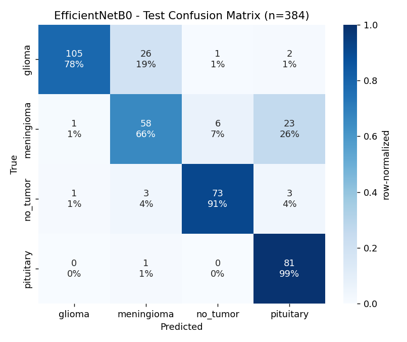

# 🧠 NeuroScan-AI: Brain Tumor MRI Classification & Explainability

<p align="center">
  <a href="https://neuroscan-ai-1-6v54.onrender.com/"></a>
  <a href="https://neuro-scan-ai-jevr.vercel.app/"></a>
  <a href="https://github.com/Adarsh-Intelligence/NeuroScan-AI"></a>
  
  
  
  
  
</p>

---

### 🚀 **Live Production Application**
> Experience real-time deep learning brain tumor classification and Grad-CAM heatmaps directly in your browser:
>
> 👉 **[https://neuroscan-ai-1-6v54.onrender.com/](https://neuroscan-ai-1-6v54.onrender.com/)** *(Full-Stack Cloud Application)*  
> 👉 **[https://neuro-scan-ai-jevr.vercel.app/](https://neuro-scan-ai-jevr.vercel.app/)** *(Edge Static Mirror)*  
> 👉 **[Interactive API Documentation (Swagger UI)](https://neuroscan-ai-1-6v54.onrender.com/docs)**

---

## 📌 Overview

**NeuroScan AI** is an end-to-end, leakage-resilient medical deep learning system designed for multi-class classification of cranial magnetic resonance imaging (MRI) scans. Built on **EfficientNetB0** transfer learning with gradient-weighted class activation mapping (**Grad-CAM**), the system provides both diagnostic probability distributions and visual interpretability to reveal regions of interest driving predictions.

| Class | Anatomical Description | Typical Characteristics on MRI |
|---|---|---|
| 🧠 **Glioma** | Originates from glial cells supporting neurons | Infiltrative, irregular contrast enhancement with surrounding edema |
| 🛡️ **Meningioma** | Typically benign tumor arising from the meninges | Extra-axial, well-circumscribed, dural tail sign |
| 🔬 **Pituitary** | Neoplasm occurring within the sella turcica | Sellar mass, suprasellar extension, compression of optic chiasm |
| ✅ **No Tumor** | Normal, healthy cranial MRI scan | Symmetrical cerebral architecture without mass effect |

> [!WARNING]
> **Clinical Disclaimer:** NeuroScan AI is developed strictly for academic, research, and technical evaluation purposes. It is **not** a certified medical diagnostic tool (SaMD) and must not be used as a standalone substitute for expert radiological consultation.

---

## ✨ Key Highlights

- **🛡️ Strict Data Leakage Prevention:** Public biomedical datasets often contain near-identical augmented copies across splits. We employ MD5 byte verification, 64-bit perceptual hashing (pHash), and disjoint-set Union-Find clustering to guarantee **zero patient/group overlap** across training, validation, and test sets.
- **🎯 Dual-Architecture Protocol:** Direct head-to-head empirical comparison between a custom 4-block CNN built from scratch and a two-stage fine-tuned **EfficientNetB0**, selected solely on validation macro-F1 and validated on held-out test data.
- **🔍 Grad-CAM Visual Explainability:** High-resolution gradient attribution heatmaps overlayed directly on cranial slices, helping verify feature localization.
- **🛡️ Radiometric & Anatomical Quality Filter:** Automatic pre-inference screening to safely reject general photos, non-cranial images, or corrupted files, preventing false-positive predictions.
- **⚡ Production Cloud Architecture:** Containerized with Docker on Debian Bookworm, running an async **FastAPI** backend with CPU memory optimizations (`MALLOC_ARENA_MAX=2`, single-threaded tensor math) designed to fit within 512 MB RAM environments.

---

## 📊 Model Performance & Benchmarks

The benchmarked model is **EfficientNetB0** evaluated on **384 held-out test images** that were never seen during feature extraction or hyperparameter tuning:

### Core Evaluation Metrics

| Metric | Score | Clinical Relevance |
|---|---|---|
| **Overall Accuracy** | **89.84%** | Total correctly classified scans |
| **Macro F1-Score** | **0.894** | Balanced score across all four classes regardless of size |
| **Weighted F1-Score** | **0.899** | Proportional performance metric |
| **Macro Precision** | **0.892** | Positive predictive value across tumor types |
| **Macro Recall** | **0.898** | Diagnostic sensitivity across tumor types |

### Detailed Per-Class Breakdown

| Class | Precision | Recall (Sensitivity) | F1-Score | Test Support |
|---|---|---|---|---|
| **Glioma** | **0.976** | 0.910 | **0.942** | 134 scans |
| **Meningioma** | 0.789 | 0.807 | **0.798** | 88 scans |
| **No Tumor (Healthy)** | 0.924 | 0.913 | **0.918** | 80 scans |
| **Pituitary Tumor** | 0.878 | **0.963** | **0.919** | 82 scans |

### Inference Latency & Resource Utilization

| Specification | Metric Value | Note |
|---|---|---|
| **Total Parameters** | 4.05 Million | Lightweight and portable |
| **Serialized Model Weight** | 44.3 MB (`model.keras`) | Fits in edge environments |
| **Single-image CPU Latency** | ~28 ms | Near real-time inference |
| **Peak Inference Memory** | ~220 MB RAM | Optimized for 512MB free tier containers |

<p align="center">
  
</p>

---

## 🏗️ System Architecture & Workflow

```
┌─────────────────────────┐
│ Raw Biomedical Scans    │ (2,443 images across 4 classes)
└────────────┬────────────┘
             │
             ▼
┌─────────────────────────┐
│ 1. Integrity & pHash    │ Deduplication: MD5 + 64-bit DCT perceptual hash
│    (src/data_loader.py) │ Union-Find grouping to prevent data leakage
└────────────┬────────────┘
             │
             ▼
┌─────────────────────────┐
│ 2. Leakage-Safe Split   │ Stratified Group K-Fold (70% Train / 15% Val / 15% Test)
│    (src/prepare_data.py)│ Zero augmented clone overlap
└────────────┬────────────┘
             │
             ▼
┌─────────────────────────┐
│ 3. Deep Learning Engine │ EfficientNetB0 (Stage A Frozen + Stage B Fine-Tuned)
│    (src/train.py)       │ Anatomy-preserving spatial & contrast augmentation
└────────────┬────────────┘
             │
             ▼
┌─────────────────────────┐
│ 4. Quality Control & CAM│ Radiometric scanner verification (src/inference.py)
│    (src/gradcam.py)     │ Coarse gradient feature localization heatmap
└────────────┬────────────┘
             │
             ▼
┌─────────────────────────┐
│ 5. Serving & UI Delivery│ FastAPI REST API (/api/predict) + Interactive UI
│    (Render + Vercel)    │ Dockerized on Debian Bookworm with memory-bounded arenas
└─────────────────────────┘
```

---

## 🗂️ Dataset Insights

- **Total Analyzed Scans:** 2,443 images
- **Class Breakdown:** Glioma: 805 · Pituitary: 610 · Meningioma: 545 · No Tumor: 483
- **Identified Group Leakage in Raw Splits:** 704 near-duplicate pairs and 272 duplicate clusters crossing standard split boundaries. Our pipeline re-splits strictly at the cluster group level.
- **Split Distribution:**
  - **Train:** 1,699 images (69.6%)
  - **Validation:** 360 images (14.7%)
  - **Held-Out Test:** 384 images (15.7%)

---

## 💻 REST API Reference

The backend provides a high-performance RESTful API documented with OpenAPI (Swagger):

| Method | Endpoint | Description | Response Type |
|---|---|---|---|
| `GET` | `/` | Serves the interactive web interface | `text/html` |
| `GET` | `/health` | Service health check and model loading state | `application/json` |
| `POST` | `/api/predict` | Analyzes uploaded MRI scan (multipart form) | `application/json` |
| `GET` | `/api/classes` | Returns list of classes and labels | `application/json` |
| `GET` | `/api/metrics` | Returns test metrics and performance summary | `application/json` |

### Sample Inference Request (cURL)

```bash
curl -X POST "https://neuroscan-ai-1-6v54.onrender.com/api/predict" \
     -H "accept: application/json" \
     -F "file=@brain_scan.jpg"
```

### Sample JSON Response

```json
{
  "is_valid_mri": true,
  "predicted_class": "glioma",
  "predicted_label": "Glioma",
  "confidence": 0.9842,
  "probs": {
    "glioma": 0.9842,
    "meningioma": 0.0104,
    "no_tumor": 0.0031,
    "pituitary": 0.0023
  },
  "latency_ms": 29.4,
  "gradcam_base64": "data:image/jpeg;base64,...",
  "original_base64": "data:image/jpeg;base64,...",
  "disclaimer": "NeuroScan AI is a research decision-support tool, not an autonomous medical diagnostic device."
}
```

---

## 🛠️ Local Installation & Development

### 1. Clone & Set Up Environment

```bash
# Clone the repository
git clone https://github.com/Adarsh-Intelligence/NeuroScan-AI.git
cd NeuroScan-AI

# Create and activate virtual environment
python -m venv .venv
source .venv/bin/activate       # On Windows: .venv\Scripts\activate

# Install dependencies
pip install -r requirements.txt

# Install TensorFlow for your hardware:
pip install "tensorflow==2.18.*"             # CPU only (Windows / Linux)
# Or for CUDA GPU acceleration:
pip install "tensorflow[and-cuda]==2.18.*"
```

### 2. Run Local Test Suite

```bash
python -m pytest -q
```

### 3. Launch Local Web Application

```bash
python run_server.py --port 8000
```
Open **[http://localhost:8000](http://localhost:8000)** in your browser to view the interface.

---

## 🐳 Running with Docker

Run the entire application in an isolated, production-grade container:

```bash
# Build the optimized production image
docker build -t neuroscan-ai .

# Run container on port 8000
docker run -p 8000:8000 neuroscan-ai
```

---

## 📁 Repository Structure

```
NeuroScan-AI/
├── .github/                       # CI/CD workflows
├── artifacts/
│   ├── metrics/                   # Test classification report, predictions CSV
│   ├── models/efficientnet/       # Serialized production model & configs
│   ├── plots/                     # Confusion matrices, accuracy/loss curves
│   └── splits/                    # Leakage-safe train/val/test CSV splits
├── notebooks/
│   └── 01_project_walkthrough.ipynb # Comprehensive end-to-end walkthrough
├── src/
│   ├── config.py                  # Global hyperparameters & paths
│   ├── data_loader.py             # Data inspection, MD5, and pHash grouping
│   ├── explore.py                 # Dataset analysis report generation
│   ├── prepare_data.py            # Stratified group split generator
│   ├── preprocessing.py           # Image normalization & tf.data pipeline
│   ├── augmentation.py            # Anatomy-safe spatial & intensity augmentations
│   ├── models/
│   │   ├── custom_cnn.py          # 4-block baseline CNN
│   │   └── efficientnet.py        # EfficientNetB0 transfer learning architecture
│   ├── train.py                   # Two-stage training engine with callbacks
│   ├── inference.py               # Optimized inference & QC validation engine
│   ├── gradcam.py                 # Grad-CAM heatmap generation & overlays
│   └── evaluate.py                # Performance calculation & error analysis
├── tests/                         # Full automated pytest test suite
├── app.py                         # Production FastAPI application
├── index.html                     # Responsive single-page interactive UI
├── run_server.py                  # Standalone server CLI runner
├── requirements-prod.txt          # Minimal memory-bounded production dependencies
├── requirements.txt               # Full development dependencies
├── Dockerfile                     # Production container image (Debian Bookworm)
├── render.yaml                    # Automated cloud deployment blueprint
└── vercel.json                    # Static frontend configuration
```

---

## 👨‍💻 Author & Contributions

**Adarsh Dwivedi**  
- GitHub: [@Adarsh-Intelligence](https://github.com/Adarsh-Intelligence)  
- Project Repository: [NeuroScan-AI](https://github.com/Adarsh-Intelligence/NeuroScan-AI)  
- Live Deployment: [https://neuroscan-ai-1-6v54.onrender.com/](https://neuroscan-ai-1-6v54.onrender.com/)

---

<p align="center">
  <sub>Engineered with precision for medical computer vision research & reproducible deep learning.</sub>
</p>